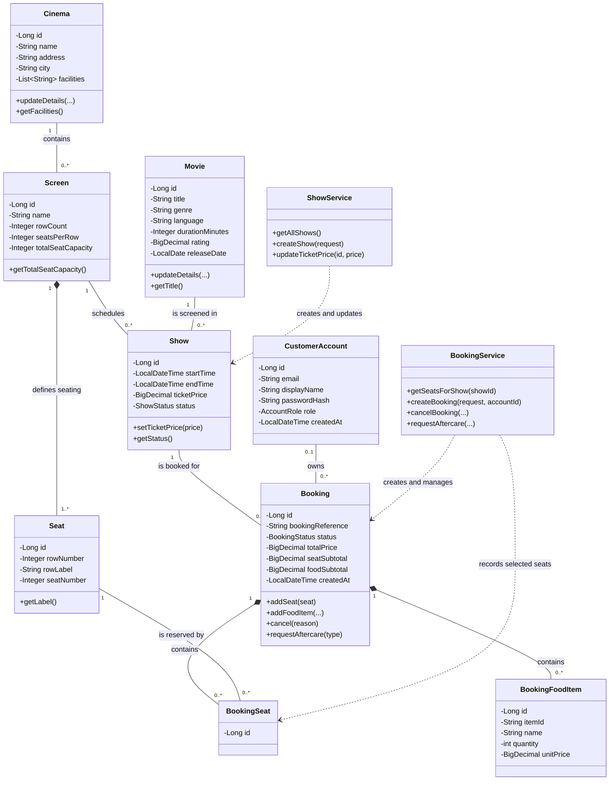
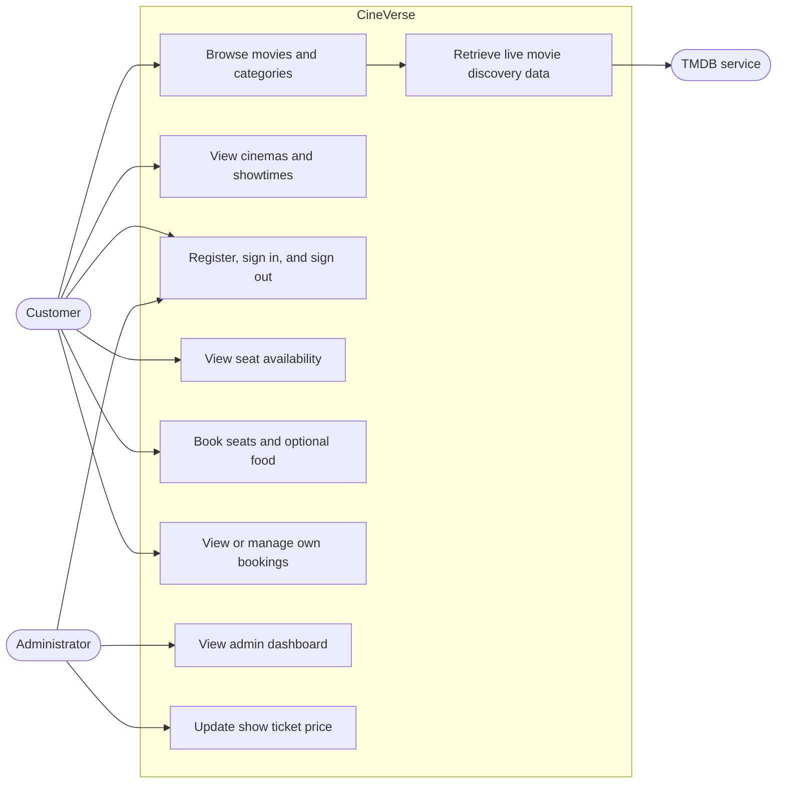
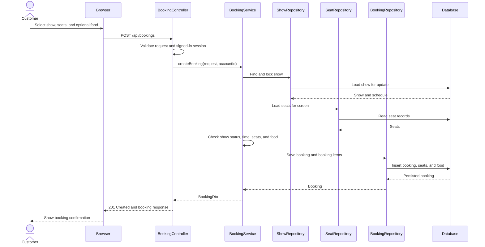

# CineVerse — Object-Oriented Modeling Project Report

## 1. Project overview

CineVerse is a web-based cinema discovery and ticket-booking application. Customers can browse movies, cinemas, screens, and showtimes; create an account; select seats; place a booking with optional food; and manage or review their bookings. Administrators can view booking summaries and update show prices. Optional live movie discovery is provided through a server-side TMDB integration.

The backend is written in Java 17 with Spring Boot, Spring MVC, Spring Data JPA, and Jakarta Bean Validation. The browser interface is served from the application's static resources and communicates with the backend over HTTP.

### Main layers

| Layer | Responsibility | Examples |
|---|---|---|
| Controller | Maps HTTP requests to application actions and responses | `BookingController`, `AuthController`, `AdminController` |
| Service | Implements business rules and transaction boundaries | `BookingService`, `ShowService`, `CustomerAccountService` |
| Repository | Defines database access | `BookingRepository`, `MovieRepository`, `ShowRepository` |
| Entity | Represents persistent domain data and its relationships | `Booking`, `Movie`, `Cinema`, `Show`, `CustomerAccount` |
| DTO | Defines request and response data exchanged over HTTP | `CreateBookingRequest`, `BookingDto`, `ShowDto` |
| Exception handling | Converts expected failures into structured HTTP responses | `GlobalExceptionHandler`, domain exceptions |

This separation keeps HTTP concerns, business rules, persistence, and domain data from being concentrated in a single class.

## 2. System design and UML

### 2.1 Class diagram

The diagram presents the central domain objects, representative fields and operations, and their key associations. `BookingSeat` and `BookingFoodItem` record the items belonging to a booking. The diamond indicates lifecycle-dependent composition in the persistence model.



In the diagram, one `Show` belongs to exactly one `Movie` and one `Screen`; the opposite ends can have multiple shows. A booking can be associated with a customer account, while the domain model permits the account reference to be absent. Seat reservation records connect a booking, a show, and a physical seat.

### 2.2 Use-case diagram



The administrator signs in through an admin flow and must have the server-side `ADMIN` role to access administrative operations. Live discovery is optional; the local catalog remains available when TMDB is not configured.

### 2.3 Booking sequence diagram



If input is invalid, the show is unavailable, or a requested seat has already been booked, the service raises a domain exception and the request returns an appropriate error response instead of a successful booking.

## 3. Object-oriented principles

### Encapsulation

Entity state is kept in private fields. Callers access information through getters and make supported changes through behavior-oriented methods rather than directly changing fields. For example:

- `Cinema.updateDetails(...)` updates cinema information, while `getFacilities()` returns an unmodifiable list.
- `Movie.updateDetails(...)` performs a grouped movie update.
- `Booking.addSeat(...)`, `addFoodItem(...)`, `cancel(...)`, and `requestAftercare(...)` control changes to booking state.
- `Booking` returns copies of its booking-seat and food-item lists rather than exposing its mutable collections.

This reduces accidental invalid state changes and makes domain operations easier to locate.

### Inheritance

The principal business entities (`Movie`, `Cinema`, `Show`, `Booking`, and others) do not extend a shared entity superclass. The project avoids inventing an inheritance hierarchy where the domain does not require one.

Inheritance is used where it fits exception categorization: `MovieNotFoundException`, `CinemaNotFoundException`, `ScreenNotFoundException`, and `ShowNotFoundException` extend `ResourceNotFoundException`, which is itself a runtime exception. This lets the global handler treat all missing resources consistently while preserving specific exception types.

### Polymorphism and overloading

- `DevelopmentMovieDataLoader` and `DemoCustomerDataLoader` implement Spring Boot's `ApplicationRunner` interface and provide their own `run(...)` implementations. Spring invokes these implementations through the interface callback when the application starts.
- `Booking` has overloaded constructors for different creation inputs (for example, with or without a customer account or explicit subtotals). This is compile-time overloading; it is not runtime subtype polymorphism.
- `BookingRepository` extends Spring Data JPA's `JpaRepository` interface. It redeclares `findById` with an entity-graph annotation so related data is loaded for that repository operation.

There is no custom inheritance-based runtime-polymorphism hierarchy in the main booking domain.

### Abstraction

- Repository interfaces express the persistence operations needed by services without requiring services to depend on concrete SQL or database implementation classes.
- Service classes provide an application-level interface to business operations, such as `BookingService.createBooking(...)`.
- DTOs abstract the database entity structure from the JSON request and response contracts.
- Spring's `PasswordEncoder` abstraction is injected into account services, separating password hashing use from the concrete encoder configuration.

## 4. Design patterns and architectural techniques

| Pattern or technique | Use in CineVerse |
|---|---|
| Model–View–Controller (MVC) | Controllers expose HTTP endpoints, services apply rules, and entity/DTO classes represent domain and exchanged data. |
| Repository | Spring Data repository interfaces centralize persistence operations and are injected into services. |
| Data Transfer Object (DTO) | Request and response DTOs keep API payloads separate from JPA entities. |
| Dependency Injection | Spring supplies repositories and services through constructors, improving modularity and testability. |
| Transaction Script / service layer | Service operations define business workflows and transaction boundaries using `@Transactional`. |
| Domain-specific exception handling | Domain exceptions are mapped centrally to structured HTTP error responses. |

The project does not define its own GoF Factory or Observer implementation. Spring-managed services are singleton-scoped by default, but this is framework lifecycle behavior rather than a manually implemented Singleton pattern.

## 5. Validation, exception handling, and concurrency

Request DTOs use Jakarta Bean Validation and controller parameters use constraints such as positive IDs. The service layer applies business checks that require loaded domain data, including:

- Whether the show is scheduled and still in the future.
- Whether selected seats belong to the show's screen and remain available.
- Whether requested food items exist in the menu.
- Whether a show conflicts with another show on the same screen.
- Whether customer or administrator access is appropriate.

`GlobalExceptionHandler` uses Spring's `@RestControllerAdvice` to translate errors into an `ApiError` response with a timestamp, HTTP status, message, request path, and field-level errors when available. Typical status categories include `400 Bad Request` for invalid input, `401 Unauthorized` for missing or invalid authentication, `403 Forbidden` for denied access, `404 Not Found` for missing resources, and `409 Conflict` for business or data conflicts. TMDB discovery failures can also return an explicit service error.

Booking creation is transactional. The service locks the show while checking availability, and a database uniqueness constraint on the show/seat reservation protects against duplicate reservations. These safeguards help prevent concurrent requests from confirming the same seat for one show.

## 6. Database and persistence

JPA entities map domain objects to relational tables. Relationships are represented with foreign keys and JPA associations; value collections such as cinema facilities and dependent booking items are persisted with their owning records.

- **Default development configuration:** H2 in-memory database. Hibernate creates and drops the schema during application startup/shutdown (`create-drop`), so the database is reset when the application restarts. Startup data loaders populate sample movie, cinema, screen, show, and demo-account records.
- **Production configuration:** `application-prod.properties` is set up for PostgreSQL, using environment-provided connection values and schema update mode. The production profile and its environment configuration must be supplied when deploying.
- **External movie data:** optional TMDB discovery is fetched through the backend. The API key is configured through an environment variable rather than stored in the browser or source code.

There is no CSV or JSON file database. JSON is used as the HTTP API format; persistent domain data is stored through JPA in the configured relational database.

## 7. Application screenshots

These screenshots illustrate the customer booking journey and the separate administrator experience in CineVerse.

### Movie discovery

The home page highlights a movie and provides a starting point for browsing the catalog.

.png>)

### Seat selection

Customers can view the seating layout and their selected seats before continuing.


### Booking confirmation

The booking confirmation shows the details of a completed reservation.


### Administrator dashboard

The admin dashboard summarizes booking activity and ticket information.


## 8. Summary

CineVerse demonstrates object modeling through domain entities, associations, encapsulated state changes, interface-based abstractions, and a layered application architecture. Its design emphasizes separation of responsibilities: controllers handle HTTP, services implement use cases, repositories persist data, and entities model business concepts. Inheritance is used selectively for exceptions rather than imposed on unrelated domain types, and the report distinguishes constructor overloading from runtime polymorphism.

## 9. Running the application

From the project directory, start the backend with:

```powershell
mvn spring-boot:run
```

Then open `http://localhost:8080` in a browser. The in-memory development data is recreated when the application restarts.
